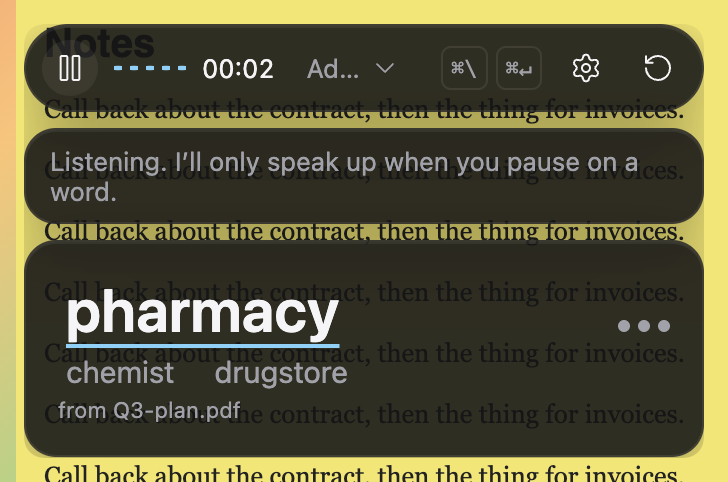
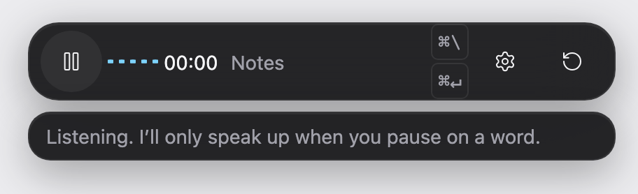
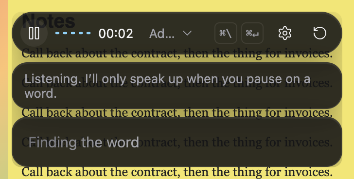
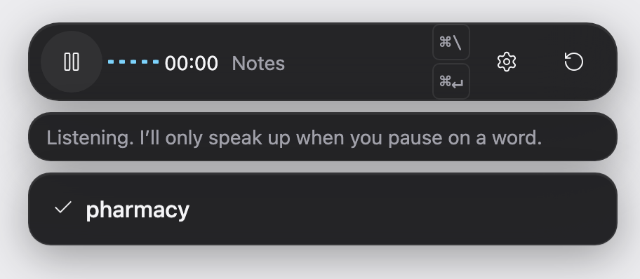
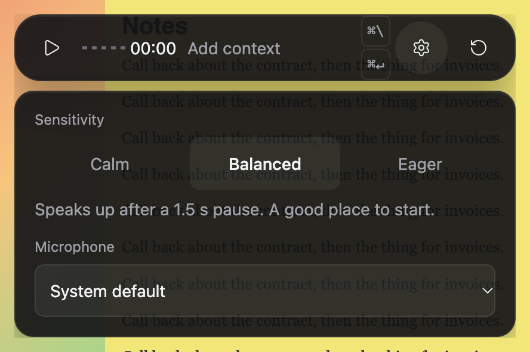

# Tip of the Tongue

A live word-finding companion. It listens to your conversation. When you stall on a word mid-sentence, a small overlay offers up to three likely words, or just the first sound if you prefer. It stays silent while you speak fluently, while you are still finding the word yourself, and while someone else is talking.

It's for anyone who loses words mid-conversation: in meetings, interviews and calls, or day to day. That includes people with anomic aphasia, brain fog or a stammer, older speakers, and people speaking a second language.

Entry for the **Hiya Voice AI Challenge, Accessibility track**.

<p align="center">
  
</p>

## Features

- **Spots stalls in any kind of speech.** It triggers on a pause, a filler, a cue phrase ("what's it called") or a description of the thing ("the place where you get medicine"). The pause threshold adapts to each speaker's pace. It stays quiet during stutters and blocks, and it never offers a word you have just rejected ("the fork, no, the…").
- **Only your stalls count.** Deepgram tells the voices apart, so the other person's pauses never trigger it.
- **Fast.** Guessing starts while you are still pausing. The pop-up typically appears 1.4–1.7 s after your last word.
- **Uses context.** Drop in a meeting document (PDF, Markdown or text) and it uses that document's names and terms. "About you" adds your name, your role and words you often need. Words you accept are remembered on this device, as words only and never transcripts, so the next meeting already knows them.
- **You decide how much help you get.** First sound only, the whole word, or only when you ask. Sensitivity runs from Calm to Eager.
- **Desktop overlay.** An always-on-top macOS window with a menu-bar icon. It never takes focus and stays visible when you share your screen.
- **Recovers from everyday failures.** It reconnects after a network drop or Mac sleep, recovers when a mic is unplugged or switched, and warns about muted or very quiet input.

| Listening                                     | Thinking                                    | Accepted                                    | Help settings                               |
| --------------------------------------------- | ------------------------------------------- | ------------------------------------------- | ------------------------------------------- |
|  |  |  |  |

## Quick start

You need Node 22 (`nvm use`). It runs from a clean clone with **no API keys**: you get a mock guesser and the browser's speech recognition (Chrome or Edge).

```bash
npm install
npm run dev     # server on :3000, web app on http://localhost:5173
npm run app     # desktop overlay (macOS); needs DEEPGRAM_API_KEY for speech
```

For real use, copy `.env.example` to `.env` and add:

| Variable            | What it enables                                                                                                                                                                  |
| ------------------- | -------------------------------------------------------------------------------------------------------------------------------------------------------------------------------- |
| `ANTHROPIC_API_KEY` | Real word guessing with Claude (default model `claude-haiku-5-5`). Without it, a mock guesser runs.                                                                              |
| `DEEPGRAM_API_KEY`  | Streaming speech-to-text (Nova-3) with real word timings, filler words and speaker labels. Without it, the browser's speech recognition is used. The desktop app needs this key. |

Optional settings are in `.env.example`: a personal profile file, sensitivity and the allowed browser origins.

### Keyboard shortcuts (desktop overlay)

| Keys         | Action                                                                       |
| ------------ | ---------------------------------------------------------------------------- |
| ⌘\\          | Show or hide the overlay                                                     |
| ⌘↵           | Ask for a word now                                                           |
| ⌘1 / ⌘2 / ⌘3 | Pick a suggestion (taken from other apps only while a suggestion is showing) |
| Esc          | Dismiss a suggestion                                                         |
| ⌘⇧N          | New conversation (clears everything heard)                                   |

On Windows and Linux use Ctrl instead of ⌘. In the browser, add `?debug=1` for developer tools.

## Install the desktop app (macOS)

`npm run dist` builds two installers in `release/`: `Tip of the Tongue-0.1.0-arm64.dmg` (Apple silicon) and `Tip of the Tongue-0.1.0.dmg` (Intel). Open one and drag the app to Applications. The app is **not signed yet**, so the first time, right-click it and choose Open, then Open again (or allow it in System Settings › Privacy & Security). It asks for the microphone on first use. Paste your own keys in the app; they are stored encrypted in the macOS keychain, and no `.env` is needed.

## How it works

```
mic ─▶ speech-to-text ─▶ stall detector ─▶ Claude guesser ─▶ gate ─▶ overlay
       (Deepgram or       (pause, fillers,    (context, profile,  (confidence,
        browser)           pace, stutter,      document; streamed, repeats,
                           self-corrections)   abstains if unsure) cooldown)
```

The server holds one session per connection. It keeps the transcript in memory, decides when you are stuck, asks Claude for candidates, and offers them only when confident. A word you then say is counted as accepted. Details are in [docs/ARCHITECTURE.md](docs/ARCHITECTURE.md).

## Evidence

All numbers come from our own scripted conversations, which are not real users. LLM results vary between runs. 95% Wilson intervals are in brackets.

| Test                                                        | Result                                                                                                       |
| ----------------------------------------------------------- | ------------------------------------------------------------------------------------------------------------ |
| 20 whole conversations (dev split), real Claude, three runs | 82–86% of stalls get the right word. 1–2 pop-ups in 165 fluent lines. 0–1 on the other speaker in 251 lines. |
| Slow, breathy and self-correcting speakers                  | Right word on 9–11 of 11 stalls. A rejected word is never offered.                                           |
| Live audio (macOS voices through real Deepgram and Claude)  | 6/8 stalls, 0 wrong, 0/22 fluent pop-ups                                                                     |

Hard and holdout sets, the methods and the caveats are in [docs/write-up.md](docs/write-up.md). Research on how people speak, and the design choices it led to, is in [docs/RESEARCH.md](docs/RESEARCH.md).

## Development

```bash
npm run lint && npm run typecheck && npm test && npm run build   # required before a PR
npm run e2e                                                      # Playwright UI tests
npm run eval -- --set hard --split dev --guesser claude          # word-guess evaluation
npm run scenarios -w eval -- --guesser claude --split dev       # whole-conversation replay
```

```
server/   Fastify + WebSocket pipeline (session, stall detector, guesser, gate, Deepgram)
web/      React overlay (pill, suggestion card, prep drawer, settings)
app/      Electron shell for the desktop overlay
eval/     Offline evaluation, scenario replay, live-audio harness
e2e/      Playwright tests
data/     Evaluation sets and an example profile
docs/     Architecture, research, edge cases, write-up, status
```

CI runs lint, typecheck, unit tests and the build on Linux, macOS and Windows with Node 22 and 24, plus the end-to-end tests.

## Privacy and security

- No audio is stored. With Deepgram, audio is streamed for transcription only while you are listening.
- Transcripts live in memory for the session and go only to the configured speech-to-text and AI providers. Info-level logs never contain your words.
- The local server accepts WebSocket connections only from `ALLOWED_ORIGINS` (and from its own port when `WEB_DIST` is set). With `TOTT_TOKEN` set, a socket must also open with `?token=<it>` or it is closed with code 4401; the token is compared in constant time and never logged. Message size, word count and word length are capped.

## Limitations

- **Not tested with people with aphasia**, and we make no clinical claim. The evidence comes from scripted conversations and synthetic voices.
- Speech-to-text can mishear atypical speech. Severe dysarthria is a known weak spot for every recogniser.
- With browser speech there are no speaker labels, so the other person's pauses can trigger a guess.
- When you mix languages, it can offer the foreign word itself rather than the English one. A language setting is in progress.

See [docs/EDGE-CASES.md](docs/EDGE-CASES.md) for the full list.

## Licence

MIT © Aryan Sajiv. See [LICENSE](LICENSE). How AI was used to build this project is in [ai.md](ai.md).
