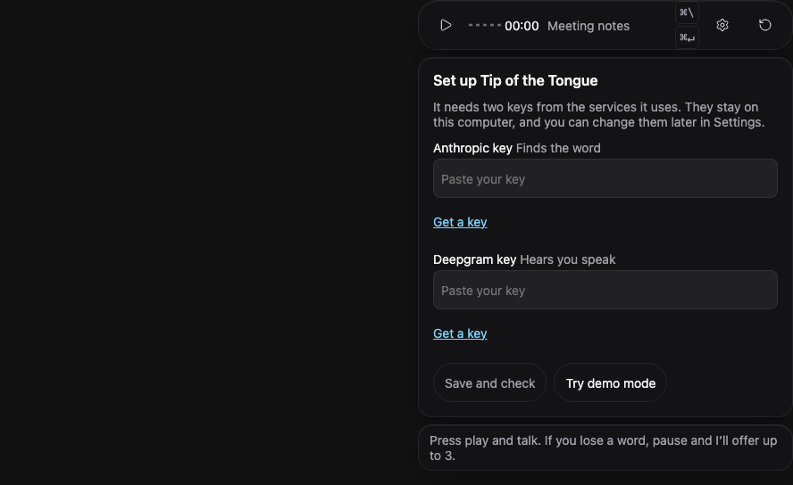
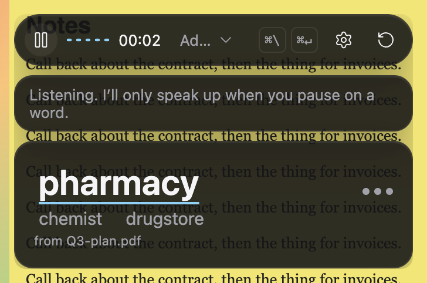
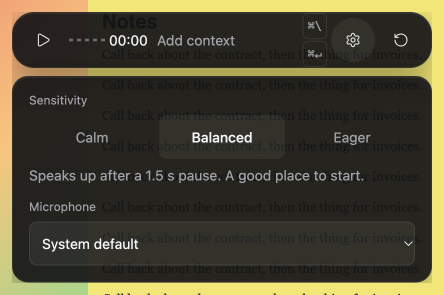

# Tip of the Tongue: user guide

A small pop-up that listens while you talk and, when you get stuck on a word, offers up to three guesses. It is quiet when you are fluent, and quiet while you are finding the word yourself.

**What it is not.** It is not a medical device, and we make no claim that it helps anyone clinically. It guesses, and it can be wrong. We have tested it on our own written examples, not with people who have aphasia. If you use it with others in the room, remember that one microphone hears everyone.

## 1. Install

1. Download the app from the project's releases page and open the download.
2. Drag **Tip of the Tongue** into your Applications folder.
3. The first time only: **right-click the app and choose Open**, then choose **Open** again in the box that appears. The app is not signed by Apple yet, so a normal double-click is refused. After this one time it opens normally.
4. A small icon appears in the menu bar at the top of the screen. The pop-up lives at the top right of your screen.

## 2. Get your two keys

The app needs two keys, one from each service it uses. They are like passwords that let the app use your own account. **You pay each service directly for what you use; the app itself has no charge.** We do not state prices here, because they change. Check each provider's own page before you start:

| Key                | What it does    | Get it                                                                             | Pricing                                                    |
| ------------------ | --------------- | ---------------------------------------------------------------------------------- | ---------------------------------------------------------- |
| Anthropic (Claude) | Finds the word  | [console.anthropic.com/settings/keys](https://console.anthropic.com/settings/keys) | [anthropic.com/pricing](https://www.anthropic.com/pricing) |
| Deepgram           | Hears you speak | [console.deepgram.com/signup](https://console.deepgram.com/signup)                 | [deepgram.com/pricing](https://deepgram.com/pricing)       |

Step by step, for each one:

1. Open the link above and make an account.
2. Add a payment method if the provider asks for one. Some providers give starting credit to new accounts; their pricing page says whether that applies to you.
3. Create a key. Copy it straight away: most providers show it only once.
4. Paste it into the matching box in the app (next section).

Keep your keys private. The app stores them on your computer, encrypted with your Mac's keychain, and never shows them again after you save them.

## 3. First run

1. The app opens a **Set up** panel. Paste each key into its box and press **Save and check**.
2. Each key gets a tick (**Works**) or a plain reason, such as "Deepgram did not accept this key. Check that you copied all of it." Fix it and press **Save and check** again. Press **Done** when both work.
3. No keys yet? Press **Try demo mode**. You will see the whole app, but the suggestions are only examples (a banner says so). You can add keys later under **Settings > Keys**.
4. Next, the app asks **How should I help when you're stuck?** Choose one: **First sound**, **Whole word** or **Only when I ask** (see section 6). You can change it later.
5. Press **Play** and talk. The first time, your Mac asks to let the app use the microphone. Choose Allow.

## 4. What the pop-up does, and when it stays quiet

- When you pause on a word, say a phrase like "what's it called", or describe the thing instead of naming it, the app asks Claude for likely words and shows up to three. The main word is large; the others are underneath. The dots show how sure the guess is.
- **Pick a word** by clicking it, pressing **⌘1, ⌘2 or ⌘3**, or simply saying it. The card shows a tick and goes away.
- **Dismiss** it with **Esc**. It also fades after about 6 seconds, but **stays while you hover over it or have it focused**.
- It stays **silent** when you are speaking fluently, when you find the word yourself, when someone else is talking (with Deepgram the app tells voices apart, but it chooses yours from your first words after Start and can choose wrong), during a stutter or block, and when it is not confident enough. Staying silent is on purpose.
- A word it has offered is kept off the list for about 3 minutes, so you are not shown the same word again and again.

## 5. Shortcuts

| Keys (Mac)    | What it does                                            |
| ------------- | ------------------------------------------------------- |
| **⌘ \\**      | Show or hide the pop-up                                 |
| **⌘ Return**  | "I'm stuck, help now": asks for a word straight away    |
| **⌘ ⇧ N**     | Start a new conversation (forgets what was heard)       |
| **⌘ 1, 2, 3** | Pick the first, second or third word while a card shows |
| **Esc**       | Dismiss the card                                        |

The app is for macOS. If you try the page in a browser on Windows or Linux, Ctrl takes the place of ⌘, and **Space** also asks for a word unless a button or a box has focus. The menu-bar icon has Show or Hide, Pause or Start listening, New conversation and Quit, and is getting Settings and Recent words.

## 6. Settings

Open it with the gear button.

- **How I help.** _First sound_ shows just the start of the word, like "w…", and you tap it (or press ⌘ Return again) to see the whole word. _Whole word_ shows the words straight away. _Only when I ask_ shows nothing unless you press ⌘ Return or say something like "what's it called".
- **How quickly I offer words.** _Calm_ waits for a longer pause and only speaks when quite sure. _Balanced_ is the default. _Eager_ speaks up sooner, even when less sure, and is wrong more often. The app also adapts to how fast you talk.
- **Language.** English, Español, Français, Deutsch, हिन्दी, or **Mixed languages** if you switch between languages mid-sentence. Pick the one you speak most of the time; recognition is less accurate for accents and mixed speech.
- **Text size.** Normal or Large. Large makes the words and notes bigger; the control bar keeps its size.
- **Theme.** Light or dark, following your computer's setting. There is nothing to switch in the app.
- **Microphone.** Choose which microphone to use.
- **Keys.** Paste, check or remove your keys.
- **Privacy.** See section 7.

**Meeting notes** (the button on the control bar): drop in a PDF, Markdown or text file, and the app uses its names and terms. **About you** holds your name, role and words you often need.

## 7. Privacy: what is kept, and where

- **Audio is not stored.** While you listen, your voice is streamed to Deepgram to be turned into text, and is not saved by the app.
- **The conversation is not saved.** What was heard is kept in memory while the app runs, and gone when you press New conversation or quit.
- **Claude sees text.** To find a word, the app sends Anthropic the recent words of the conversation, your meeting notes and the words in About you. Both providers handle that under their own terms; read them if this matters to you.
- **On your computer only:** your settings, your name, role and words from About you, and **remembered words** (words you accepted, never what was said around them). Your keys are kept encrypted with the keychain. Meeting notes are not saved: they last until you remove them or quit.
- **To forget:** open **Settings > Privacy**. Each remembered word has a remove button. **Forget everything** (it asks you to confirm) clears About you, remembered words and your meeting notes. **Clear About you** in the Meeting notes panel clears only that. Remove a key under **Settings > Keys**.

## 8. Troubleshooting

**No pop-ups appear.**

- Is the microphone on? The control bar shows the level. Press Play if it is paused.
- It is meant to stay quiet unless you pause on a word. Try saying "I need the... um... the thing for the..." and wait a moment, or press ⌘ Return.
- Is the **Demo** banner showing? Then the suggestions are examples. Add your keys.
- Is _Only when I ask_ chosen? Then it waits for you to ask.

**"Microphone access was blocked."** Open **System Settings > Privacy & Security > Microphone**, turn on Tip of the Tongue, then press Start.

**"Key invalid" ("did not accept this key").** Copy the key again, all of it, with no spaces, and paste it in **Settings > Keys**. Make sure the key is for the right service (Anthropic for the first box, Deepgram for the second) and that the account is active and has credit.

**"Your Anthropic key isn't working."** The service refused the key. Check it in **Settings > Keys**.

**"Suggestions paused for a moment; the AI service is busy."** Anthropic is busy or you are over a limit. The app tries again by itself; you do not need to do anything.

**"Could not reach..."** Check your internet connection. The app reconnects by itself.

**A "Demo: suggestions are examples" banner.** There is no Anthropic key, so you see made-up suggestions. Add a key under **Settings > Keys**.

**"Another tab is already listening."** Only one window listens at a time. Close the other copy of the app, or the other browser tab, and this one takes over.

**The app says a port is in use, or does not start.** Another copy of the app, or another program, is using a port it needs. Choose **Quit** from the menu-bar icon (also check there is no second copy), then open the app again. If it still fails, restart your computer.

**Still stuck?** Tell us what you saw and what you were doing; please do not send your keys.
